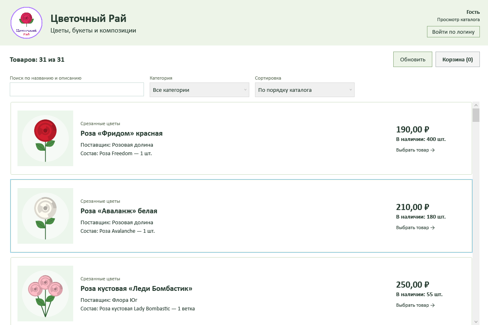

# Цветочный Рай

Настольное приложение для заказа цветов, букетов и композиций по требованиям из `source-data/Приложение 1 Описание предметной области Цветочный Рай.docx`.

**C# · WPF · Microsoft SQL Server · ADO.NET · .NET Framework 4.8**



## Быстрый запуск

На Windows с .NET Framework 4.8 и SQL Server Express LocalDB запустите **Launch.cmd**. Скрипт создаст базу `FlowerParadise`, импортирует данные и откроет приложение. Повторный запуск сохраняет изменения в базе.

Скачивайте весь проект: приложению нужны папка `Assets` и файл `FlowerParadise.exe.config` рядом с `FlowerParadise.exe`. Полная инструкция: [START.md](START.md).

| Логин | Пользователь | Роль |
|---|---|---|
| `morlov` | Орлов Максим Андреевич | Администратор |
| `kbelova` | Белова Ксения Игоревна | Менеджер |
| `dmorozova` | Морозова Дарья Сергеевна | Авторизованный пользователь |

Вход только по логину, без пароля — как указано в задании. Все 20 исходных пользователей сохранены.

## Возможности

- Гость просматривает каталог и карточки товаров.
- После входа доступны совместные поиск по названию и описанию, фильтр категории и сортировка цены.
- Срезанные цветы имеют размеры 40–90 см; букеты и композиции — S, M, L, XL. В карточке показаны размерный ряд, доступные размеры и остатки.
- Корзина содержит несколько товаров и размеров; можно менять количество, удалять позиции, отменять и подтверждать заказ.
- Менеджер и администратор видят все заказы, даты, ФИО клиентов, суммы и состав заказа; оформляют заказы на выбранного клиента и удаляют заказы.
- Администратор дополнительно меняет дату заказа, количество в его позиции и удаляет отдельные позиции. При изменении количества сохраняется историческая цена.
- База повторно проверяет роль пользователя, актуальность цены и остатки. Оформление, удаление и изменение количества выполняются в транзакциях.

Цены взяты из исходных данных и показаны в рублях. Изображения, логотип, иконка и заглушка взяты из архива задания.

## Состав проекта

| Путь | Назначение |
|---|---|
| `FlowerParadise.exe`, `FlowerParadise.exe.config` | Готовое приложение и настройки подключения |
| `Launch.cmd` | Подготовка базы и запуск |
| `FlowerParadise.sln`, `src/FlowerParadise/` | Решение Visual Studio, C# и XAML |
| `Assets/` | Изображения товаров и оформление |
| `database/database_with_data.sql` | Полный SQL-скрипт создания базы и загрузки данных |
| `database/01_schema.sql`, `database/02_seed.sql` | Схема и исходные данные раздельно |
| `database/csv_3nf/` | 10 связанных таблиц в CSV UTF-8 с BOM, разделитель `;` |
| `database/import-summary.json` | Контрольные итоги импорта |
| `source-data/` | Неизменённые файлы исходного задания |
| `docs/USER_GUIDE.md` | Руководство пользователя |
| `docs/NORMALIZATION.md`, `docs/ER_DIAGRAM.md` | Обоснование структуры и ER-диаграмма |
| `docs/REQUIREMENTS.md` | Соответствие требованиям |
| `docs/TESTING.md`, `tests/IntegrationTests.cs` | Проверки и порядок повторения |
| `Build.ps1`, `Run-Tests.ps1` | Сборка и запуск проверок |

Контроль импорта: **31 товар, 73 товарные позиции, 1 910 доступных единиц, 20 пользователей, 10 заказов, 31 строка заказов, 133 заказанные единицы, 115 735,00 ₽**. Остатки из Excel считаются готовым снимком доступного количества; исторические заказы повторно из них не вычитаются.

## Сборка и проверка

```powershell
powershell.exe -NoProfile -ExecutionPolicy Bypass -File .\Build.ps1
powershell.exe -NoProfile -ExecutionPolicy Bypass -File .\Run-Tests.ps1
```

Сборка не требует NuGet, SDK .NET или Visual Studio. Альтернативный способ — открыть `FlowerParadise.sln` в Visual Studio с компонентами WPF и .NET Framework 4.8.

## Основа проекта

Приложение адаптировано из предоставленного пользователем проекта [milkuzza/ChudoObuv-WPF-MSSQL](https://github.com/milkuzza/ChudoObuv-WPF-MSSQL). Изменены предметная область, данные, размеры, изображения и оформление; добавлено редактирование количества в существующем заказе. Реализация проверена по требованиям из приложенного архива. Код входа по логину предназначен для данного учебного задания.
