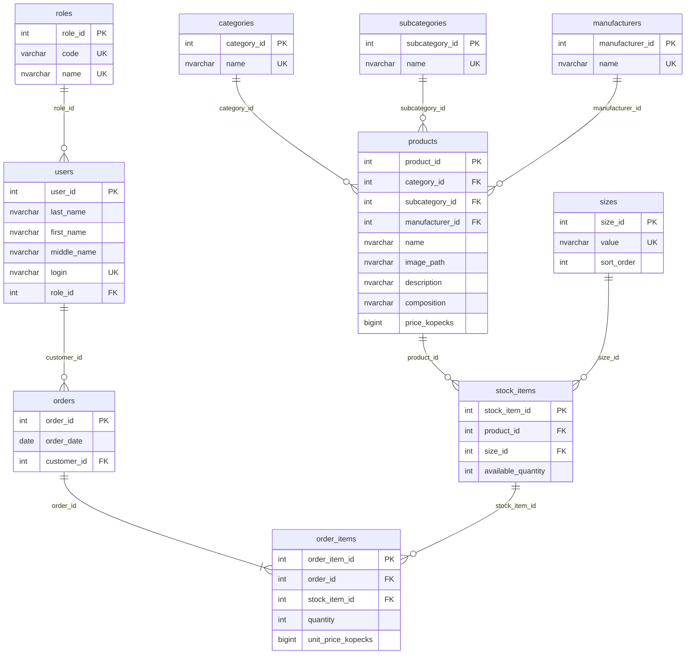

# ER-диаграмма

Составные уникальные ключи: products(name, manufacturer_id), stock_items(product_id, size_id), order_items(order_id, stock_item_id). Удаление заказа каскадно удаляет строки; возврат остатков выполняется приложением в той же транзакции. Наличие хотя бы одной строки заказа обеспечивает слой операций с данными.
