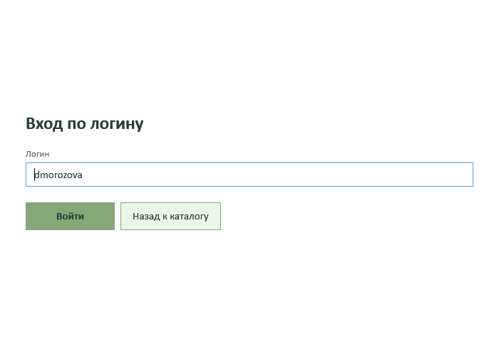
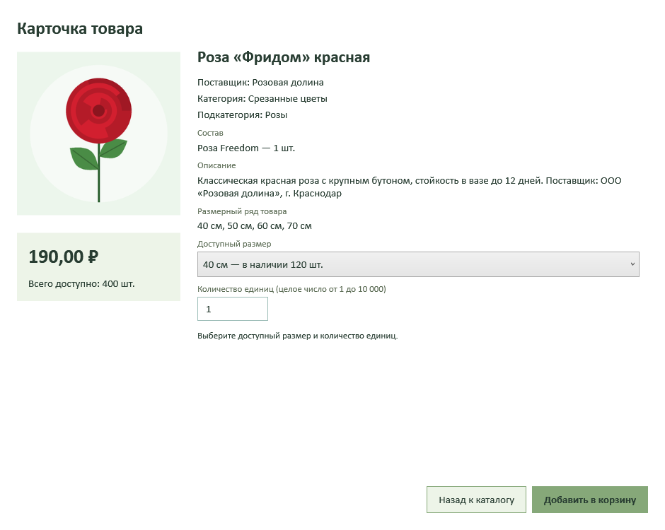
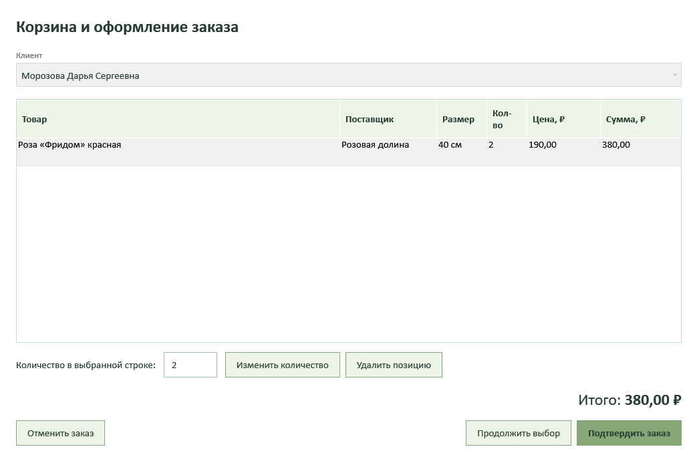
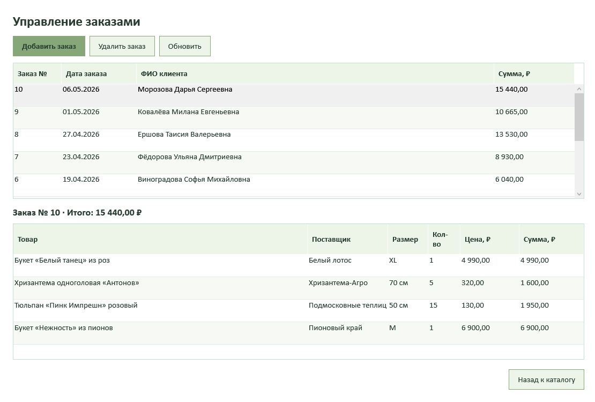
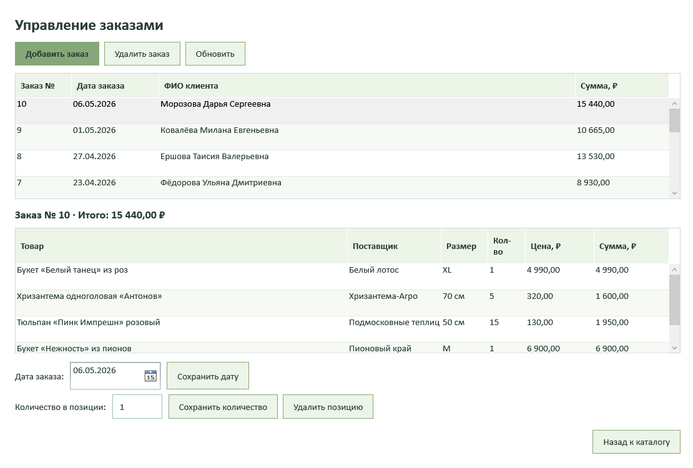

# Руководство пользователя

## Каталог и вход

После запуска отображается каталог цветов, букетов и композиций. Для каждого товара видны категория, название, поставщик, состав, изображение, цена и суммарный остаток. Если у товара не задано изображение, используется исходная заглушка `picture.png`.

Гость может открывать карточки товаров. Для оформления заказа нажмите «Войти по логину». Введите логин из списка пользователей; пароль не нужен. После входа справа сверху показаны ФИО и роль. При выходе неоформленная корзина очищается после подтверждения.

## Поиск и выбор товара

У авторизованного пользователя поиск, категория и сортировка работают совместно. Поиск проверяет название и описание без учёта регистра. Кнопка «Обновить» загружает текущие цены и остатки, сохраняя выбранные параметры.

Нажмите на строку товара или выделите её и нажмите Enter. В карточке показаны подробное описание, состав, поставщик и размеры. Для срезанных цветов размер означает длину стебля в сантиметрах; для букетов и композиций используются S, M, L, XL. Выпадающий список содержит только размеры с положительным остатком. Выберите размер и целое количество, затем нажмите «Добавить в корзину».

## Корзина и оформление

Откройте «Корзина». Здесь отображаются все выбранные сочетания товара и размера, количество, цена и сумма. Чтобы изменить количество, выберите строку, введите новое значение и нажмите «Изменить количество». Можно удалить отдельную строку, продолжить выбор или отменить всю корзину.

Обычный пользователь оформляет заказ на себя. Менеджер и администратор могут выбрать клиента из списка. Нажмите «Подтвердить заказ» и подтвердите клиента и сумму. Приложение проверит текущие цены и остатки, запишет заказ и уменьшит остатки. Если товара недостаточно, заказ полностью откатывается.

## Работа менеджера

Кнопка «Заказы» открывает список дат, ФИО клиентов и итоговых сумм. Выберите заказ, чтобы увидеть его состав. Кнопка «Добавить заказ» возвращает в каталог для подбора товаров; клиент выбирается в корзине. «Удалить заказ» удаляет заказ после подтверждения и возвращает его количество в остатки.

## Работа администратора

Администратору доступны все действия менеджера и дополнительные поля редактирования. Выберите заказ, измените дату и нажмите «Сохранить дату». Для изменения количества выделите строку состава, введите целое число и нажмите «Сохранить количество». Увеличение потребует достаточного остатка; уменьшение вернёт разницу в наличие. Цена за единицу сохранится такой, какой была при оформлении заказа.

«Удалить позицию» удаляет выбранную строку и возвращает её количество в остатки. Удалить последнюю строку отдельно нельзя: используйте «Удалить заказ».

Допустимое количество в одной позиции — от 1 до 10 000, в пределах фактического наличия. Все суммы выражены в рублях и копейках.
